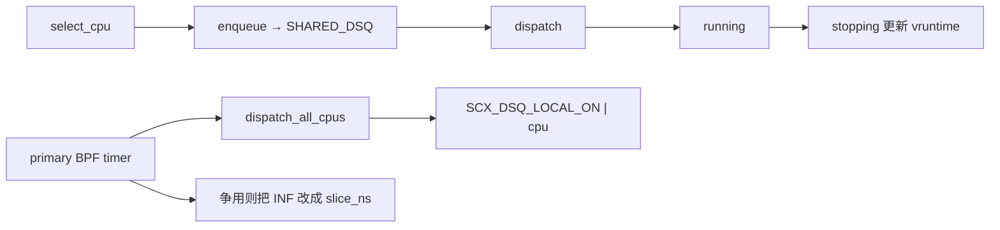

# scx_tickless

This is a single user-defined scheduler used within [`sched_ext`](https://github.com/sched-ext/scx/tree/main), which is a Linux kernel feature which enables implementing kernel thread schedulers in BPF and dynamically loading them. [Read more about `sched_ext`](https://github.com/sched-ext/scx/tree/main).

## Overview

`scx_tickless` is a server-oriented scheduler designed for cloud computing,
virtualization, and high-performance computing workloads.

The scheduler works by routing all scheduling events through a pool of
primary CPUs assigned to handle these events. This allows disabling the
scheduler's tick on other CPUs, reducing OS noise.

By default, only CPU 0 is included in the pool of primary CPUs. However,
the pool size can be adjusted using the `--primary-domain CPUMASK` option.
On systems with a large number of CPUs, allocating multiple CPUs to the
primary pool may be beneficial.

Tasks are placed into a global queue and the primary CPUs are responsible
for distributing them to the other "tickless" CPUs. Preemption events are
sent from the primary CPUs via IPC only when a "tickless" CPU is being
contended by multiple tasks.

The primary CPUs also perform the check for a contended CPU and the
frequency of this check can be adjusted with the `--frequency FREQ` option.
This effectively determines the tick frequency on the "tickless" CPUs when
multiple tasks are competing for them.

NOTE: in order to effectively disable ticks on the "tickless" CPUs the
kernel must be booted with `nohz_full`. Keep in mind that `nohz_full`
introduces syscall overhead, so this may regress latency-sensitive
workloads.

## Typical Use Case

Typical use cases include cloud computing, virtualization and high
performance computing workloads. This scheduler is not designed for
latency-sensitive workloads.

## Production Ready?

This scheduler is still experimental.
已读完该目录下的 BPF 与用户态代码。下面按总体设计、实现路径、再专门讲任务分发/“工作窃取”来说明。

## 总体设计与特点

`scx_tickless` 是面向云、虚拟化、HPC 的 **集中式调度器**：把调度决策集中到一小撮 **primary CPU**，其余 CPU 尽量 **无 tick 跑任务**，降低 OS noise。

核心思路可以概括成三句话：

1. **调度事件走 primary 池**：wakeup、enqueue、周期扫描都尽量落在 primary CPU 上。
2. **任务先进全局队列**：所有可运行任务进入一个全局 `SHARED_DSQ`，由 primary CPU / BPF timer 再分到 tickless CPU。
3. **无竞争则无限时间片**：tickless CPU 上的任务默认 `SCX_SLICE_INF`；只有该 CPU 被多个任务争用时，才由 primary 侧 timer 改成有限 `slice_ns` 并触发抢占。

这和 CFS/典型 work-stealing 调度器相反：不是每个 CPU 自己维护本地队列、空闲时去偷邻居，而是 **中央队列 + 主动分发**，用“避免争用”换“可以关 tick”。

### 角色划分

| 角色 | 职责 |
|------|------|
| **Primary CPU**（默认只有最慢的那颗，可用 `--primary-domain` 指定） | 接收 wakeup、跑 BPF timer、把全局队列任务推到 tickless CPU；队列挤满时自己也干活 |
| **Tickless CPU** | 尽量只跑任务，不处理调度中断；默认无限时间片 |
| **SHARED_DSQ** | 全局可运行队列，按 deadline（加权 vruntime）排序 |

用户态还会按 **CPU capacity 降序** 填 `preferred_cpus[]`，分发时优先把任务放到大核。默认 primary 选 **容量最低** 的 CPU（排序后最后一个），把调度噪声赶到小核上。

真正关 tick 还依赖内核 `nohz_full`。没有它，调度器仍能跑，但 tickless CPU 上硬件 tick 关不掉；`nohz_full` 本身也会增加 syscall 开销，所以 README 明确说不适合延迟敏感负载。状态仍是 experimental。

### 关键可调参数

- `--primary-domain`：primary 集合；`0` 表示自动选最慢核
- `--slice-us`：争用时的有限时间片（默认 20ms）
- `--frequency`：primary 上检查争用/分发的频率（0 = `CONFIG_HZ`）
- `--nosmt`：关闭“先填满空闲 SMT 核”的偏好

---

## 实现结构

调度逻辑几乎全在 BPF（`src/bpf/main.bpf.c`）；Rust 用户态只做拓扑、参数、primary 集合、以及在指定 CPU 上启动 BPF timer。

### 用户态启动路径

```120:208:scheds/rust/scx_tickless/src/main.rs
    fn init(opts: &'a Opts, open_object: &'a mut MaybeUninit<OpenObject>) -> Result<Self> {
        // ...
        // 按 capacity 降序排列 CPU
        cpus.sort_by_key(|cpu| std::cmp::Reverse(cpu.cpu_capacity));
        // primary 为空 → 选最慢核
        // 把线程绑到第一个 primary CPU，attach 后再 start_timer
```

BPF timer 必须在 **当前 CPU 就是目标 primary** 时启动（`start_timer` 里检查 `cpu == bpf_get_smp_processor_id()`），所以用户态先 `set_thread_affinity`，再 `test_run(start_timer)`。

打开的 struct_ops 标志：

- `SCX_OPS_ENQ_LAST`：当前任务也走 enqueue，便于统一进全局队列
- `SCX_OPS_ENQ_MIGRATION_DISABLED`：迁移被禁用的任务也走 BPF enqueue
- `SCX_OPS_ALLOW_QUEUED_WAKEUP`：允许 queued wakeup

### 任务生命周期（BPF ops）



**`select_cpu`**：同步唤醒（`SCX_WAKE_SYNC` 且 waker 非退出）直接回 waker CPU，近似函数调用；其余一律 `pick_primary_cpu()`（primary 池里随机一颗），并 `scx_bpf_test_and_clear_cpu_idle` 把该 CPU 从 idle 集合里摘掉，避免稍后分发路径再把它当空闲目标。

**`enqueue`**：不算本地队列，一律 `scx_bpf_dsq_insert_vtime(..., SHARED_DSQ, SCX_SLICE_INF, deadline)`。时间片先给无限，后面只在争用时改有限。

**Deadline / 公平性**：

\[
\text{deadline} = \text{vruntime} + \text{exec\_vruntime}
\]

- `vruntime`：运行时间按权重反比缩放，保证公平
- `exec_runtime`：从变为 runnable 到自愿让出 CPU 的连续执行量；经常阻塞的交互任务这项更小，deadline 更短，更早被选出
- 睡眠任务的 vtime 预算钳在 `vtime_now - slice_ns`，避免睡太久后饿死别人
- `stopping` 里 `exec_runtime` 最多累计 1s，避免纯 CPU 任务被过度降权

**`dispatch`**：若当前是 primary，先把全局队列尽量推到 tickless CPU；然后 **任何 CPU**（含 primary）都可以 `scx_bpf_dsq_move_to_local(SHARED_DSQ)` 拉一条；若还没有新任务且 `prev` 仍可运行，继续给 `SCX_SLICE_INF`。

**`tick`**：只计数 `nr_ticks`。真正的“伪 tick”在 primary 的 `sched_timerfn`。

---

## 工作窃取：这里实际是什么

这个调度器 **没有** 经典 work-stealing：没有 per-CPU 任务队列互相偷、没有 victim 选择、也没有从别的 CPU 的 `LOCAL DSQ` 里 `dsq_move`。

它用的是 **全局队列上的集中分发 + 空闲拉取**：

- **Push（主路径）**：primary 的 `ops.dispatch` 和 BPF timer 调用 `dispatch_all_cpus()`，按容量顺序把 `SHARED_DSQ` 里的任务 **推到** 空闲 tickless CPU 的 local DSQ。
- **Pull（次路径）**：某个 CPU 进入 `ops.dispatch` 且本地没有现成工作时，`scx_bpf_dsq_move_to_local(SHARED_DSQ)` 从全局队列 **拉一条**。对 tickless CPU 来说，这最接近“从共享池偷活”。
- **Primary 兜底**：tickless 都忙完后，primary 自己也消费全局队列，避免任务积压。

所以“窃取”发生在 **任务 vs 全局 SHARED_DSQ**，不是 **CPU vs CPU 本地队列**。设计目标是 **尽量不让两个任务挤同一颗 tickless CPU**，这样才能一直用无限时间片、少打断。

### 1. 分发扫描：`dispatch_all_cpus`

```345:401:scheds/rust/scx_tickless/src/bpf/main.bpf.c
static bool dispatch_all_cpus(bool do_idle_smt, bool from_dispatch)
{
	if (!scx_bpf_dsq_nr_queued(SHARED_DSQ))
		return true;
	// ...
	mask = do_idle_smt ? scx_bpf_get_idle_smtmask() : NULL;

	bpf_for(i, 0, MIN(nr_cpu_ids, MAX_CPUS)) {
		cpu = preferred_cpus[i];
		if ((mask && !bpf_cpumask_test_cpu(cpu, mask)))
			continue;
		scx_bpf_kick_cpu(cpu, SCX_KICK_IDLE);
		if (is_primary_cpu(cpu))
			continue;          // primary 不当分发目标
		dispatch_cpu(cpu, from_dispatch);
		if (!scx_bpf_dsq_nr_queued(SHARED_DSQ)) {
			is_done = true;
			break;
		}
	}
```

要点：

1. **两阶段**：先 `do_idle_smt=true`（只考虑整个 SMT 核都空闲的 CPU），失败再 `false`（半空闲 sibling 也可以）。先填满空核，减少 SMT 争用。
2. **容量优先**：按 `preferred_cpus`（capacity 降序）扫描，大核先拿到活。
3. **先 kick 再派**：`SCX_KICK_IDLE` 唤醒空闲 CPU；若最终没派上任务，该 CPU 会自己回到 idle。
4. **跳过 primary**：分发目标只含 tickless CPU，primary 留作调度控制面和最后的算力。
5. **队列空就停**：一次尽可能把 SHARED_DSQ 摊开，而不是把多任务堆到同一颗 CPU。

调用点有两处，统计分开：

- `tickless_dispatch` → `nr_primary_dispatches`
- `sched_timerfn` → `nr_timer_dispatches`

空闲 CPU 在 `dispatch` 里自己 `move_to_local` 则记 `nr_direct_dispatches`。这三条路径就是所有“把任务放到某颗 CPU 上”的来源。

### 2. 针对单核的“匹配 + 反争用”：`dispatch_cpu`

这是分发策略的核心：

```272:334:scheds/rust/scx_tickless/src/bpf/main.bpf.c
static bool dispatch_cpu(s32 cpu, bool from_dispatch)
{
	bpf_for_each(scx_dsq, p, SHARED_DSQ, 0) {
		if (!bpf_cpumask_test_cpu(cpu, p->cpus_ptr))
			continue;   // 亲和性不匹配，看下一个任务

		if (!scx_bpf_test_and_clear_cpu_idle(cpu) && !is_pcpu_task(p))
			break;      // CPU 不空闲，且任务可迁移 → 放弃这颗 CPU

		scx_bpf_dsq_move(..., SCX_DSQ_LOCAL_ON | cpu, ...);
		break;              // 一颗 CPU 最多派一个
	}
}
```

对每个候选 CPU：

1. 在 **全局 DSQ 按 deadline 顺序** 找第一个能在这颗 CPU 上跑的任务（亲和性 `cpus_ptr`）。
2. **占用 idle**：`test_and_clear_cpu_idle` 成功说明这颗核现在空，可以把任务推过去。
3. **忙则宁可不派**：CPU 不空闲、且任务不是 per-CPU 任务时直接 `break`——不为这颗核再找下一个任务，也不制造双任务争用。任务继续留在 SHARED_DSQ，等别的空闲核或下一轮 timer。
4. **per-CPU 例外**：`nr_cpus_allowed == 1` 或 `migration_disabled` 的任务只能跑这颗核，即使忙也要 `dsq_move` 过去。争用不可避免，随后由 timer 把正在跑的任务从 `SCX_SLICE_INF` 改成有限片，避免这种任务饿死。
5. **一核一条**：成功 move 后立刻停，把其余任务留给后面的 CPU。这是“均匀摊开、避免争用”的直接实现。

这和 work-stealing 的直觉相反：stealing 通常是 **空闲者去找忙者**；这里是 **分发者只往空闲者送**，忙者除非有绑核任务，否则不再加活。

### 3. 空闲 CPU 的 pull：算不算偷？

Tickless CPU 进入 `tickless_dispatch` 时：

```500:528:scheds/rust/scx_tickless/src/bpf/main.bpf.c
void BPF_STRUCT_OPS(tickless_dispatch, s32 cpu, struct task_struct *prev)
{
	if (is_primary_cpu(cpu)) {
		if (!dispatch_all_cpus(true, true))
			dispatch_all_cpus(false, true);
	}
	if (scx_bpf_dsq_move_to_local(SHARED_DSQ, 0)) {
		__sync_fetch_and_add(&nr_direct_dispatches, 1);
		return;
	}
	if (prev && prev->scx.flags & SCX_TASK_QUEUED)
		prev->scx.slice = SCX_SLICE_INF;
}
```

非 primary 的 tickless CPU **不会** 跑 `dispatch_all_cpus`（不会去给别人派活），只会：

1. 从 SHARED_DSQ 拉一条能在本核跑的任务（`move_to_local` 会考虑亲和性）
2. 否则让 `prev` 继续跑（无限片）

这就是唯一的 **pull-based** 路径：空闲核从全局池取活。Timer 里的 `kick_cpu(IDLE)` 是在催这些核走进 `dispatch`，从而触发这次 pull / 或配合前面已经 `dsq_move` 到其 local DSQ 的任务。

没有“看邻居 local DSQ 深不深再偷”的逻辑；邻居的 local 队列通常最多一条（刚被派来的），争用时才会在 local 上堆第二条（绑核任务）。

### 4. 何时才允许“挤在同一颗核”——抢占侧

无限时间片要成立，必须保证大多数时候一核一任务。争用探测全在 primary 的 timer：

```403:447:scheds/rust/scx_tickless/src/bpf/main.bpf.c
static int sched_timerfn(...)
{
	if (!dispatch_all_cpus(true, false))
		dispatch_all_cpus(false, false);

	bpf_for(cpu, 0, nr_cpu_ids) {
		p = current_on(cpu);
		if (!p || idle)
			continue;
		if (!local_queued(cpu) && !shared_queued)
			continue;
		if (p->scx.slice == SCX_SLICE_INF) {
			p->scx.slice = slice_ns;
			nr_preemptions++;
		}
	}
	bpf_timer_start(timer, tick_interval_ns(), 0);
}
```

对每颗正在跑用户任务的 CPU：若 **其 local DSQ 非空**（绑核任务被硬塞进来）或 **全局队列仍有人等**，就把当前任务的无限片改成 `slice_ns`。片用完后会重新 `enqueue`/`dispatch`，全局队列里 deadline 更小的任务才能上来。

`--frequency` 控制的就是这次扫描的周期，等价于：**tickless CPU 在发生争用时的有效 tick 频率**。无争用时这条路径不会改 slice，配合 `nohz_full` 就可以长时间无 tick。

---

## 设计上的取舍

**换到的东西**

- 调度中断、timer、wakeup 路由都集中在 primary，tickless 核的 OS noise 低，适合 VM/HPC 独占式负载。
- 全局 vtime 队列提供跨核公平，再用 `exec_runtime` 给短阻塞任务一点延迟倾斜。
- SMT 感知 + capacity 排序：先完整空闲大核，减少 sibling 干扰。

**付出的代价**

- Primary 是中心瓶颈；大机需要加大 `--primary-domain`。
- 不是延迟最优：wakeup 先到 primary，再经 dispatch/timer 铺到目标核，多一跳。
- “反争用”意味着有可迁移任务在等、且只剩忙核时，宁可让任务留在 SHARED_DSQ，也不立刻抢占——抢占要等下一拍 timer。吞吐/隔离优先于尾延迟。
- 没有 CPU 间 local-queue stealing，负载均衡完全依赖中央扫描顺序和空闲 pull，短时不均衡要靠 timer 频率弥补。

一句话：`scx_tickless` 把 work-stealing 换成了 **“全局队列 + 只往空闲核推 + 空闲核从全局拉”**；工作窃取的对象是 `SHARED_DSQ`，约束是 **能不争用就不争用**，这样才能在 tickless CPU 上长期使用 `SCX_SLICE_INF`。